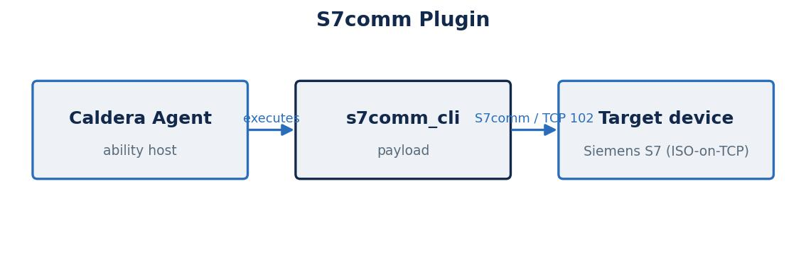

# S7comm
Siemens S7 (S7comm) protocol abilities for Caldera for OT.

v1.0.0 released 3 Nov 2026

## Overview
The S7comm plugin provides __6__ unique abilities specific to the S7comm protocol. This is accomplished not through exploitation, but rather by leveraging native functionality within the protocol. S7comm is the proprietary Siemens S7 communication protocol (ISO-on-TCP, port 102) used by the S7-300/400/1200/1500 PLC families. It has no public specification; the abilities are implemented through the open-source python-snap7 library.

The following table outlines MITRE ATT&CK for ICS coverage provided by the S7comm plugin.

|Collection|Discovery|Execution|Impair-Process-Control|Inhibit-Response-Function|
|:--|:--|:--|:--|:--|
|Monitor Process State|Remote System Discovery|Change Operating Mode|Modify Parameter|Device Restart/Shutdown|

### Ability Overview Tables
The following table(s) list each plugin ability by their corresponding tactic.

#### Collection Abilities
|Name|Tactic|Technique|Technique Id|
|:--|:--|:--|:--|
|[S7comm - Read CPU State](#s7comm---read-cpu-state)|collection|Monitor Process State|T0801|
|[S7comm - Read Data Block](#s7comm---read-data-block)|collection|Monitor Process State|T0801|

#### Discovery Abilities
|Name|Tactic|Technique|Technique Id|
|:--|:--|:--|:--|
|[S7comm - Read System Status List](#s7comm---read-system-status-list)|discovery|Remote System Discovery|T0846|

#### Execution Abilities
|Name|Tactic|Technique|Technique Id|
|:--|:--|:--|:--|
|[S7comm - Start CPU](#s7comm---start-cpu)|execution|Change Operating Mode|T0858|

#### Impair-Process-Control Abilities
|Name|Tactic|Technique|Technique Id|
|:--|:--|:--|:--|
|[S7comm - Write Data Block](#s7comm---write-data-block)|impair-process-control|Modify Parameter|T0836|

#### Inhibit-Response-Function Abilities
|Name|Tactic|Technique|Technique Id|
|:--|:--|:--|:--|
|[S7comm - Stop CPU](#s7comm---stop-cpu)|inhibit-response-function|Device Restart/Shutdown|T0816|


## Architecture
This section describes the main components of the plugin and how they interface.

### Block Diagram


The S7comm plugin exposes several new protocol specific abilities to your Caldera instance. The abilities are executed from a host running a Caldera agent via the corresponding payload. Abilities must target devices that support the S7comm protocol to achieve described effects. By default the plugin will use __102__ for all communication.

### Payloads
The S7comm plugin includes 1 distinct payload(s) that implement the abilities:

- `s7comm_cli`: &emsp; Generic Siemens S7 client; one subcommand per ability, parameterized by facts.
  - Compatible with Linux, Windows, macOS
  - Compiled with PyInstaller (Python 3.10)

### Libraries
The following libraries were used to build the S7comm payloads:  

|Library|Version|License|
|:--|:--|:--|
|[python-snap7](https://pypi.org/project/python-snap7/)|[3.x](https://pypi.org/project/python-snap7/)|[MIT](https://github.com/gijzelaerr/python-snap7/blob/master/LICENSE)|
|snap7 (native library, bundled)|[1.x](https://snap7.sourceforge.net/)|[LGPL-3.0](https://snap7.sourceforge.net/)|

## Usage
This section describes how to initially deploy and execute the abilities present within the S7comm plugin.

### Deployment
1. Identify the target system you would like to communicate with via the S7comm protocol.
2. Identify a viable host for the Caldera agent that will be sending S7comm messages to the target system.
3. Deploy the Caldera agent to the viable host.
4. Run a combination of the S7comm plugin abilities to achieve the desired effect.  

*Reference the Caldera training plugin for a step-by-step tutorial on how to deploy an agent and run abilities via an operation.*

### Abilities
#### S7comm - Read CPU State
Read the run/stop state of a Siemens S7 CPU. Reveals whether the PLC is
currently running its control program.
  

__Usage:__  
linux: (sh)  
```
COMMAND>> ./s7comm_cli #{s7comm.server.ip} --rack #{s7comm.rack} --slot #{s7comm.slot} --port #{s7comm.server.port} cpu-state

```  

__Facts:__  
- `s7comm.server.ip`: Target S7 PLC IP address
- `s7comm.rack`: CPU rack number
- `s7comm.slot`: CPU slot number
- `s7comm.server.port`: Target S7 ISO-on-TCP port (default 102)
windows: (psh)  
```
COMMAND>> .\s7comm_cli.exe #{s7comm.server.ip} --rack #{s7comm.rack} --slot #{s7comm.slot} --port #{s7comm.server.port} cpu-state

```  

__Facts:__  
- `s7comm.server.ip`: Target S7 PLC IP address
- `s7comm.rack`: CPU rack number
- `s7comm.slot`: CPU slot number
- `s7comm.server.port`: Target S7 ISO-on-TCP port (default 102)
darwin: (sh)  
```
COMMAND>> ./s7comm_cli_darwin #{s7comm.server.ip} --rack #{s7comm.rack} --slot #{s7comm.slot} --port #{s7comm.server.port} cpu-state

```  

__Facts:__  
- `s7comm.server.ip`: Target S7 PLC IP address
- `s7comm.rack`: CPU rack number
- `s7comm.slot`: CPU slot number
- `s7comm.server.port`: Target S7 ISO-on-TCP port (default 102)
#### S7comm - Read Data Block
Read a Siemens S7 data block (S7comm Read Var). Discloses process values,
setpoints, or program data held in a DB on the target CPU.
  

__Usage:__  
linux: (sh)  
```
COMMAND>> ./s7comm_cli #{s7comm.server.ip} --rack #{s7comm.rack} --slot #{s7comm.slot} --port #{s7comm.server.port} read-db #{s7comm.db.number} #{s7comm.db.start} #{s7comm.db.size} --as real

```  

__Facts:__  
- `s7comm.server.ip`: Target S7 PLC IP address
- `s7comm.rack`: CPU rack number
- `s7comm.slot`: CPU slot number
- `s7comm.server.port`: Target S7 ISO-on-TCP port (default 102)
- `s7comm.db.number`: Data block (DB) number
- `s7comm.db.start`: Start byte offset within the data block
- `s7comm.db.size`: Number of bytes to read
windows: (psh)  
```
COMMAND>> .\s7comm_cli.exe #{s7comm.server.ip} --rack #{s7comm.rack} --slot #{s7comm.slot} --port #{s7comm.server.port} read-db #{s7comm.db.number} #{s7comm.db.start} #{s7comm.db.size} --as real

```  

__Facts:__  
- `s7comm.server.ip`: Target S7 PLC IP address
- `s7comm.rack`: CPU rack number
- `s7comm.slot`: CPU slot number
- `s7comm.server.port`: Target S7 ISO-on-TCP port (default 102)
- `s7comm.db.number`: Data block (DB) number
- `s7comm.db.start`: Start byte offset within the data block
- `s7comm.db.size`: Number of bytes to read
darwin: (sh)  
```
COMMAND>> ./s7comm_cli_darwin #{s7comm.server.ip} --rack #{s7comm.rack} --slot #{s7comm.slot} --port #{s7comm.server.port} read-db #{s7comm.db.number} #{s7comm.db.start} #{s7comm.db.size} --as real

```  

__Facts:__  
- `s7comm.server.ip`: Target S7 PLC IP address
- `s7comm.rack`: CPU rack number
- `s7comm.slot`: CPU slot number
- `s7comm.server.port`: Target S7 ISO-on-TCP port (default 102)
- `s7comm.db.number`: Data block (DB) number
- `s7comm.db.start`: Start byte offset within the data block
- `s7comm.db.size`: Number of bytes to read
#### S7comm - Read System Status List
Read a Siemens S7 System Status List (SZL), e.g. module identification
(0x0011) or component identification (0x001c). Fingerprints the CPU - order
number, hardware/firmware version - for target identification.
  

__Usage:__  
linux: (sh)  
```
COMMAND>> ./s7comm_cli #{s7comm.server.ip} --rack #{s7comm.rack} --slot #{s7comm.slot} --port #{s7comm.server.port} read-szl #{s7comm.szl.id}

```  

__Facts:__  
- `s7comm.server.ip`: Target S7 PLC IP address
- `s7comm.rack`: CPU rack number
- `s7comm.slot`: CPU slot number
- `s7comm.server.port`: Target S7 ISO-on-TCP port (default 102)
- `s7comm.szl.id`: System Status List (SZL) ID to read
windows: (psh)  
```
COMMAND>> .\s7comm_cli.exe #{s7comm.server.ip} --rack #{s7comm.rack} --slot #{s7comm.slot} --port #{s7comm.server.port} read-szl #{s7comm.szl.id}

```  

__Facts:__  
- `s7comm.server.ip`: Target S7 PLC IP address
- `s7comm.rack`: CPU rack number
- `s7comm.slot`: CPU slot number
- `s7comm.server.port`: Target S7 ISO-on-TCP port (default 102)
- `s7comm.szl.id`: System Status List (SZL) ID to read
darwin: (sh)  
```
COMMAND>> ./s7comm_cli_darwin #{s7comm.server.ip} --rack #{s7comm.rack} --slot #{s7comm.slot} --port #{s7comm.server.port} read-szl #{s7comm.szl.id}

```  

__Facts:__  
- `s7comm.server.ip`: Target S7 PLC IP address
- `s7comm.rack`: CPU rack number
- `s7comm.slot`: CPU slot number
- `s7comm.server.port`: Target S7 ISO-on-TCP port (default 102)
- `s7comm.szl.id`: System Status List (SZL) ID to read
#### S7comm - Start CPU
Start a Siemens S7 CPU (S7 PLC Cold Start). Restarts the control program; used
to bring a stopped CPU back into run, or to force a restart.
  

__Usage:__  
linux: (sh)  
```
COMMAND>> ./s7comm_cli #{s7comm.server.ip} --rack #{s7comm.rack} --slot #{s7comm.slot} --port #{s7comm.server.port} cpu-start

```  

__Facts:__  
- `s7comm.server.ip`: Target S7 PLC IP address
- `s7comm.rack`: CPU rack number
- `s7comm.slot`: CPU slot number
- `s7comm.server.port`: Target S7 ISO-on-TCP port (default 102)
windows: (psh)  
```
COMMAND>> .\s7comm_cli.exe #{s7comm.server.ip} --rack #{s7comm.rack} --slot #{s7comm.slot} --port #{s7comm.server.port} cpu-start

```  

__Facts:__  
- `s7comm.server.ip`: Target S7 PLC IP address
- `s7comm.rack`: CPU rack number
- `s7comm.slot`: CPU slot number
- `s7comm.server.port`: Target S7 ISO-on-TCP port (default 102)
darwin: (sh)  
```
COMMAND>> ./s7comm_cli_darwin #{s7comm.server.ip} --rack #{s7comm.rack} --slot #{s7comm.slot} --port #{s7comm.server.port} cpu-start

```  

__Facts:__  
- `s7comm.server.ip`: Target S7 PLC IP address
- `s7comm.rack`: CPU rack number
- `s7comm.slot`: CPU slot number
- `s7comm.server.port`: Target S7 ISO-on-TCP port (default 102)
#### S7comm - Write Data Block
Write a value into a Siemens S7 data block (S7comm Write Var). Altering a DB
changes a setpoint or process parameter - e.g. a drive-speed setpoint - modifying
how the process is controlled (the Stuxnet class of manipulation).
  

__Usage:__  
linux: (sh)  
```
COMMAND>> ./s7comm_cli #{s7comm.server.ip} --rack #{s7comm.rack} --slot #{s7comm.slot} --port #{s7comm.server.port} write-db #{s7comm.db.number} #{s7comm.db.start} --real #{s7comm.write.value}

```  

__Facts:__  
- `s7comm.server.ip`: Target S7 PLC IP address
- `s7comm.rack`: CPU rack number
- `s7comm.slot`: CPU slot number
- `s7comm.server.port`: Target S7 ISO-on-TCP port (default 102)
- `s7comm.db.number`: Data block (DB) number
- `s7comm.db.start`: Start byte offset within the data block
- `s7comm.write.value`: Value to write to the data block
windows: (psh)  
```
COMMAND>> .\s7comm_cli.exe #{s7comm.server.ip} --rack #{s7comm.rack} --slot #{s7comm.slot} --port #{s7comm.server.port} write-db #{s7comm.db.number} #{s7comm.db.start} --real #{s7comm.write.value}

```  

__Facts:__  
- `s7comm.server.ip`: Target S7 PLC IP address
- `s7comm.rack`: CPU rack number
- `s7comm.slot`: CPU slot number
- `s7comm.server.port`: Target S7 ISO-on-TCP port (default 102)
- `s7comm.db.number`: Data block (DB) number
- `s7comm.db.start`: Start byte offset within the data block
- `s7comm.write.value`: Value to write to the data block
darwin: (sh)  
```
COMMAND>> ./s7comm_cli_darwin #{s7comm.server.ip} --rack #{s7comm.rack} --slot #{s7comm.slot} --port #{s7comm.server.port} write-db #{s7comm.db.number} #{s7comm.db.start} --real #{s7comm.write.value}

```  

__Facts:__  
- `s7comm.server.ip`: Target S7 PLC IP address
- `s7comm.rack`: CPU rack number
- `s7comm.slot`: CPU slot number
- `s7comm.server.port`: Target S7 ISO-on-TCP port (default 102)
- `s7comm.db.number`: Data block (DB) number
- `s7comm.db.start`: Start byte offset within the data block
- `s7comm.write.value`: Value to write to the data block
#### S7comm - Stop CPU
Stop a Siemens S7 CPU (S7 PLC Stop). Halts the control program, denying the
process its automation and inhibiting the device's response.
  

__Usage:__  
linux: (sh)  
```
COMMAND>> ./s7comm_cli #{s7comm.server.ip} --rack #{s7comm.rack} --slot #{s7comm.slot} --port #{s7comm.server.port} cpu-stop

```  

__Facts:__  
- `s7comm.server.ip`: Target S7 PLC IP address
- `s7comm.rack`: CPU rack number
- `s7comm.slot`: CPU slot number
- `s7comm.server.port`: Target S7 ISO-on-TCP port (default 102)
windows: (psh)  
```
COMMAND>> .\s7comm_cli.exe #{s7comm.server.ip} --rack #{s7comm.rack} --slot #{s7comm.slot} --port #{s7comm.server.port} cpu-stop

```  

__Facts:__  
- `s7comm.server.ip`: Target S7 PLC IP address
- `s7comm.rack`: CPU rack number
- `s7comm.slot`: CPU slot number
- `s7comm.server.port`: Target S7 ISO-on-TCP port (default 102)
darwin: (sh)  
```
COMMAND>> ./s7comm_cli_darwin #{s7comm.server.ip} --rack #{s7comm.rack} --slot #{s7comm.slot} --port #{s7comm.server.port} cpu-stop

```  

__Facts:__  
- `s7comm.server.ip`: Target S7 PLC IP address
- `s7comm.rack`: CPU rack number
- `s7comm.slot`: CPU slot number
- `s7comm.server.port`: Target S7 ISO-on-TCP port (default 102)

### Source Code
The source code for the S7comm plugin can be found inside this plugin's [src directory](/src/).

### Copyright Notice
The Siemens S7 protocol and the SIMATIC product family are trademarks of Siemens AG,
Werner-von-Siemens-Strasse 1, 80333 Munich, Germany.

This Caldera plugin is named S7comm in order to describe its scope and purpose. This
plugin is not produced by or affiliated with Siemens AG. The `s7comm_cli` payload is
built on the open-source [python-snap7](https://pypi.org/project/python-snap7/) wrapper
(MIT), which bundles the native snap7 library (LGPL-3.0).
